# Introduction and Project Overview

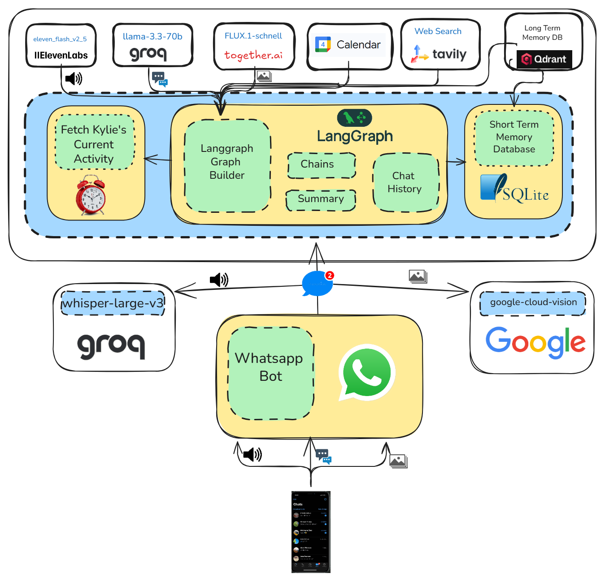

Kylie is a "Whatsapp Agent”, meaning it will interact with you through this app. But it won’t just rely on “regular” text messages, it will also listen to your voice notes (yes, even if you are one of those people 😒)and react to your pictures, add also will be able to look at your calendar, check for tasks and add tasks and reminders, and also be able to search the internet.

And that’s not all, Kylie can also respond with her own voice notes and images of what she’s up to - yes, Kylie has a life beyond talking to you, don’t be such a narcissist! 😂. This is an inspiration from a friend named Kylie that stays in Naalya.

## At this point, you might be wondering:

What kind of system have we implemented to handle multimodal inputs / outputs coherently?

The short answer: Kylie’s brain is just a graph, a LangGraph 🕸️ (sorry, I couldn’t resist).

## Kylie’s Graph
Your brain is made up of neurons, right? Well, Kylie’s brain is made up of LangGraph nodes and edges - one for image processing, another for listening to your voice, another for fetching relevant memories, and so on.

At her core, Kylie is simply a graph with a state. This state maintains all the key details of the conversation, including shared information (text, audio or images), current activities, and contextual information.

This is exactly what we'll explore in the second module below, where you'll learn how LangGraph can be used to build agentic design architectures, such as the router.

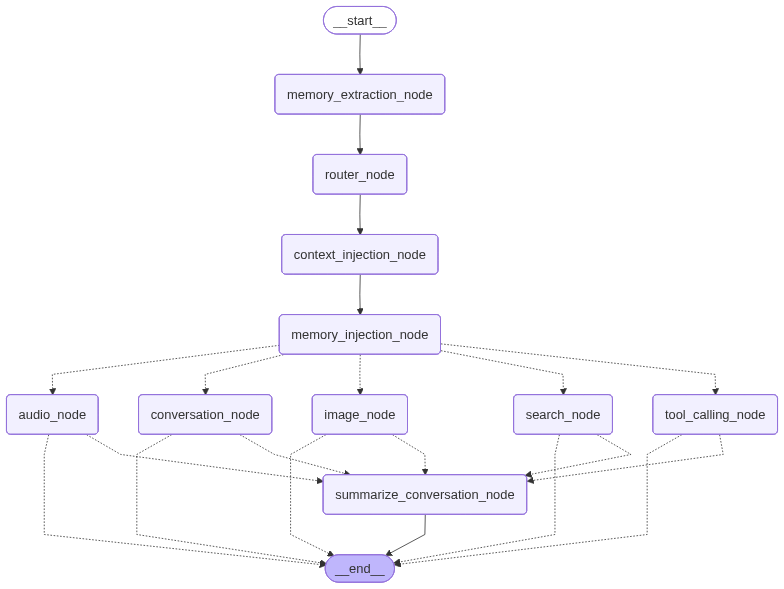

## WhatsApp Integration

Kylie receives messages through WhatsApp Cloud API webhooks. The integration handles:

- **Message Reception**: FastAPI endpoint (`/whatsapp_response`) receives webhook events from WhatsApp
- **Message Types**: Supports text, audio (voice notes), and image messages
- **Audio Processing**: Downloads audio files from WhatsApp, transcribes them using STT, and processes the text
- **Image Processing**: Downloads images from WhatsApp, analyzes them using Google Cloud Vision, and includes descriptions in conversation
- **Response Sending**: Sends responses back via WhatsApp API in text, audio, or image format
- **Session Management**: Uses phone numbers as thread IDs for conversation continuity
- **State Persistence**: Graph state is saved to SQLite using AsyncSqliteSaver checkpointing

## Graph Compilation and Execution

The graph is compiled with a checkpointer for state persistence:

- **Checkpointer**: `AsyncSqliteSaver` saves conversation state to SQLite database
- **Thread-based Sessions**: Each user (phone number) has a unique thread ID for isolated conversations
- **State Recovery**: Previous conversation state is automatically loaded when processing new messages
- **Graph Flow**: START → Memory Extraction → Router → Context Injection → Memory Injection → Workflow Branch → Summarization (conditional) → END

## Kylie’s memory
An Agent without memory is like talking to the main character of “Memento” (and if you haven’t seen that film… seriously, what are you doing with your life?).

Kylie has two types of memory:

🔷 Short term memory
The usual - it stores the sequence of messages to maintain conversation context. In our case, we save this sequence in SQLite (we are also storing a summary of the conversation).

🔷 Long term memory
When you meet someone, you don’t remember everything they say; you retain only the key details, like their name, profession, or where they’re from, right?. That’s exactly what we wanted to replicate with Qdrant - extracting relevant information from the conversation and storing it as embeddings.

we’ll cover the memory in Module 3.

## Kylie’s senses
Real Whatsapp conversations aren’t limited to just text. Think about it - do you remember the last cringe sticker your friend sent you last week? Or that neverending voice note from your high school friend? Exactly. We need both images and audio.

To make this possible, we’ve selected the following tools.

🔷 Text
I am using Groq models for all text generation. Specifically, I’ve chosen llama-3.3-70b-versatile as the core LLM.

🔷 Images
The image module handles two tasks: processing user images and generating new ones (take a look at the image below).

For image “understanding”, I've used google-cloud-vision.

For image generation, black-forest-labs/FLUX.1-schnell-Free using Together AI.

🔷 Audio
The audio module needs to take care of TTS (Text-To-Speech) and STT (Speech-To-Text).

For TTS, I'm using Elevenlabs voices.

For STT, whisper-large-v3-turbo from Groq.

I'll shared about the audio module in module 4 and the image module in module 5!

## Module 2 (Disecting Kylie's Brain)

Picture this: you’re a mad scientist living in a creepy old house in the middle of the forest, and your mission is to build a sentient robot. What’s the first thing you’d do?

Yep, you’d start with the brain, right? 🧠

So, when I started building Kylie, I also kicked things off with the “brain”.

And that’s exactly what this section is all about - building Kylie’s brain using LangGraph! 🕸️

## LangGraph in a Nutshell
Never used LangGraph before? No worries, here’s a quick intro.

LangGraph models agent workflows as graphs, using three main components:

🔶 State - A shared data structure that tracks the current status of your app (workflow).

🔶 Nodes - Python functions that define the agent behaviour. They take in the current state, perform actions, and return the updated state.

🔶 Edges - Python functions that decide which Node runs next based on the State, allowing for conditional or fixed transitions.

By combining Nodes and Edges, you can build dynamic workflows, like Kylie! In the next section, we’ll take a look at Kylie’s graph and its Nodes and Edges.

Before getting into the Nodes and the Edges, let’s describe Kylie’s state.

💠 Kylie State
As mentioned earlier, LangGraph keeps track of your app's current status using the State. Kylie’s state has these attributes:

- `summary` - The summary of the conversation so far.
- `workflow` - The Current workflow type (conversation/image/audio/tools/search).
- `audio_buffer` - The buffer containing audio data for voice messages.
- `image_path` - Path to the current image being generated. 
- `current_activity` - Description of Kylie's current simulated activity.
- `apply_activity` - Flag indicating whether to apply or update the current activity.
- `memory_context`: Retrieved memories from vector database
- `search_results`: Formatted search results from Tavily (when search is performed)

- `messages`: Conversation message history (inherited from MessagesState)

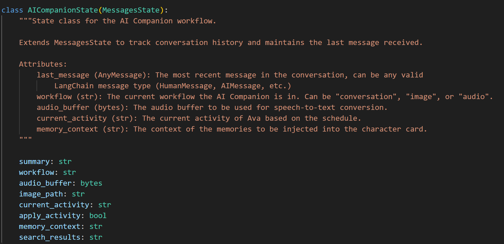

This state will be saved in an external database. Im using SQLite3 for simplicity.

Now that we know how Kylie’s State is set up, let’s check out the nodes and edges.

💠 Memory Extraction Node
The first node of the graph is the memory extraction node. This node will take care of extracting relevant information from the user conversation (e.g. name, age, background, etc.)

💠 Context Injection Node
To appear like a real person, Kylie needs to do more than just chat with you. That’s why we need a node that checks your local time and matches it with Kylie’s schedule. Kylie's schedule is hardcoded and you can change it based on what you want

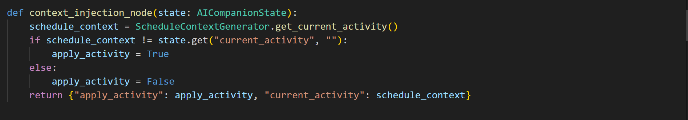

💠 Router Node
- **Purpose**: Determines the appropriate response type. The router node is at the heart of Kylie's workflow. It determines which workflow Kylie's response should follow - audio (for audio responses), image (for visual responses) or conversation (regular text replies), tools(for Calendar operations needed) and search(for Internet search needed)
- **Decision Process**:
  - Analyzes the last N messages (configurable via `ROUTER_MESSAGES_TO_ANALYZE`, default is typically 3-5)
  - Uses an LLM with structured output to classify the response type
  - Considers user intent, explicit requests, and conversation context
  - Returns one of: `conversation`, `image`, `audio`, `tools`, or `search`
- **Decision Factors**:
  - **Calendar/Tools**: Keywords like "schedule", "calendar", "events", "meetings", "appointments", "add event", "what's on my calendar"
  - **Search**: Keywords like "search for", "what is", "tell me about", "current news", "latest", "find information about"
  - **Image**: Explicit requests for images, visual content, or "show me" type queries
  - **Audio**: Explicit requests for voice notes, audio responses, or "say it" type queries
  - **Conversation**: Default for regular text-based interactions
- **Implementation**: Uses a structured output chain with temperature 0.3 for consistent routing decisions

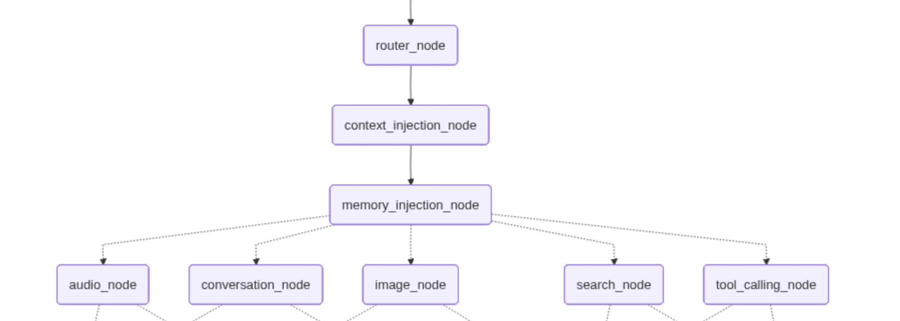

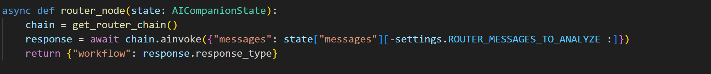

Once the Router Node determines the final answer, the chosen workflow is assigned to the "workflow" attribute of the AICompanionState. This information is then used by the select_workflow edge, which connects the router node to either the image, audio, tool, search or conversation nodes.

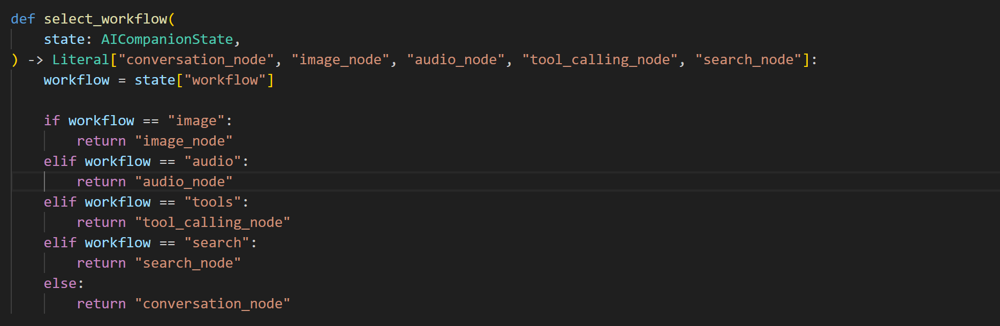

💠 Tool Calling Node
- **Purpose**: Handles calendar operations
- **Capabilities**:
  - List upcoming events (with configurable max results, default 10)
  - Add calendar events (with summary, start/end times, and optional description)
  - Get current/next event (with configurable lookahead window, default 30 minutes)
- **Calendar Integration**: Google Calendar API via direct LangChain tool integration
- **Authentication**: Uses OAuth 2.0 flow with Google Calendar API
  - Requires initial setup of `credentials.json` from Google Cloud Console
  - Stores user authorization tokens in `token.json` for subsequent use
  - Automatically refreshes expired tokens
- **Context**: Uses current date, time, and timezone (Africa/Kampala)
- **Implementation**: 
  - The `CalendarTool` class wraps Google Calendar API operations
  - LangChain tools (`list_upcoming_events`, `add_calendar_event`, `get_current_or_next_event`) are integrated into the graph
  - The router node determines when calendar operations are needed
  - Tool results are formatted and included in Kylie's response
- **Features**:
  - Automatic timezone handling (converts local times to UTC for Google Calendar)
  - Event reminders (email 24 hours before, popup 10 minutes before)
  - Error handling for invalid dates, authentication failures, and API errors

💠 Search Node
- **Purpose**: Performs internet search and generates responses with search context
- **Search Provider**: Tavily Search API
- **Process**:
  1. Extracts search query from user message
  2. Performs search using Tavily API with "advanced" search depth
  3. Formats search results (title, content preview, source URL)
  4. Generates response incorporating search results into conversation context
- **Output**: Text response with search results context, stores `search_results` in state
- **Use Cases**: Current events, news, recent information, factual queries, real-time data
- **Implementation**:
  - The `TavilySearch` class handles all search operations
  - Default max results: 5 (configurable)
  - Search results are formatted with titles, content snippets (first 200 chars), and source URLs
  - Results are injected into the character response chain as context
  - The router node determines when internet search is needed based on user queries
- **Features**:
  - Advanced search depth for comprehensive results
  - Automatic query extraction from user messages
  - Error handling for API failures and empty queries
  - Results are seamlessly integrated into Kylie's responses

💠 Summarize Conversation Node
- **Purpose**: Reduces conversation history length
- **Trigger**: When total messages exceed 100 (configurable via `TOTAL_MESSAGES_SUMMARY_TRIGGER`)
- **Process**: 
  - Creates/extends conversation summary
  - Removes old messages (keeps last 75 by default)
- **Output**: Updated summary and reduced message history

But of course, we don’t want to generate a summary every single time Kylie gets a message. That’s why this node is connected to the previous ones with a conditional edge.

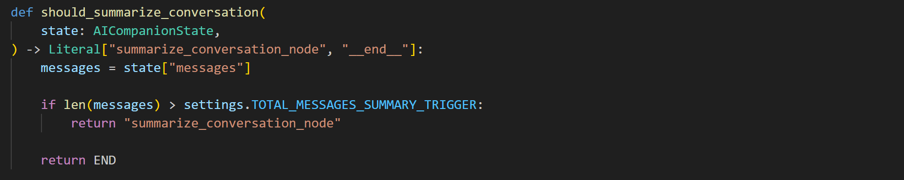

As you can see in the implementation above, this edge connects the summarization node to the previous nodes if the total number of messages exceeds the TOTAL_MESSAGES_SUMMARY_TRIGGER (which is set to 100 by default in settings.py). If not, it will connect to the END node, which marks the end of the workflow

## Module 3 (Kylie's Memory)

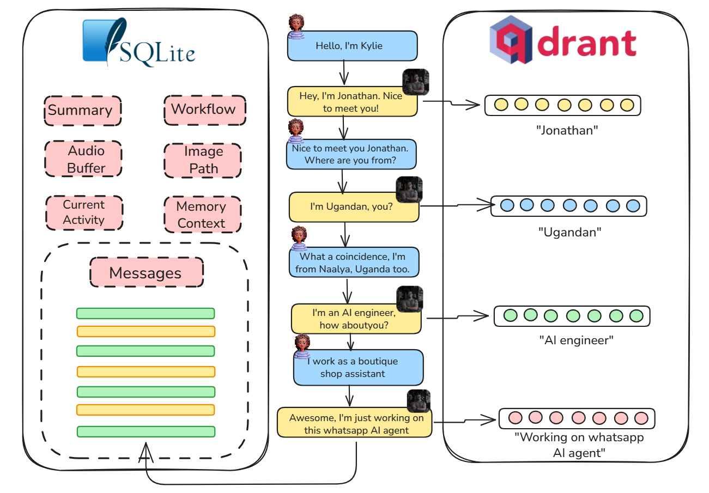

Let’s start with a diagram to give you a big-picture view. As you can see, there are two main memory “blocks” - one stored in a SQLite database (left) and the other in a Qdrant collection (right).

💠 Short-term memory
The block on the left represents the short-term memory, which is stored in the LangGraph state and then persisted in a SQLite database. LangGraph makes this process simple since it comes with a built-in checkpointer for handling database storage.

In the code, we simply use the AsyncSqliteSaver class when compiling the graph. This ensures that the LangGraph state checkpoint is continuously saved to SQLite. You can see this in action in the code below.

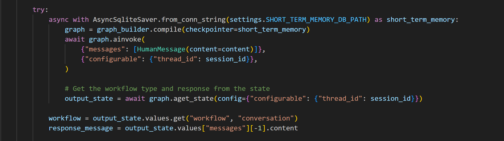

Kylie’s state is a subclass of LangGraph’s MessageState, which means it inherits a messages property. This property holds the history of messages exchanged in the conversation - essentially, that’s what we call short-term memory!

Integrating this short-term memory into the response chain is straightforward. We can use LangChain's MessagesPlaceholder class, allowing Kylie to consider past interactions when generating responses. This keeps the conversation smooth and coherent.

Simple, right? Now, let’s get into the interesting part: the long-term memory.

💠 Long-term memory

Long-term memory isn’t just about saving every single message from a conversation - far from it 😅. That would be impractical and impossible to scale. Long-term memory works quite differently.

Think about when you meet someone new, you don’t remember every word they say, right? You only retain key details, like their name, profession, where they’re from, or shared interests.

That’s exactly what we wanted to replicate with Kylie. How? 🤔

By using a Vector Database like Qdrant, that lets us store relevant information from conversations as embeddings. Let’s break this down in more detail.

🔶 Memory Extraction Node

Previously, when we talked about the different nodes in our LangGraph workflow? The first one was the memory_extraction_node, which is responsible for identifying and storing key details from the conversation.

That’s the first essential piece we need to get our long-term memory module up and running! 💪

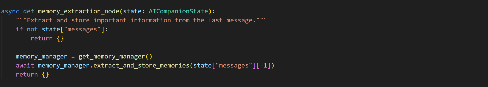

🔶 Qdrant
As the conversation progresses, the memory_extraction_node will keep gathering more and more details about you.

If you check your Qdrant Cloud instance, you’ll see the collection gradually filling up with “memories”.

🔶 Memory Injection Node
Now that all the memories are stored in Qdrant, how do we let Kylie use them in her conversations?

It’s simple! We just need one more node: the memory_injection_node.

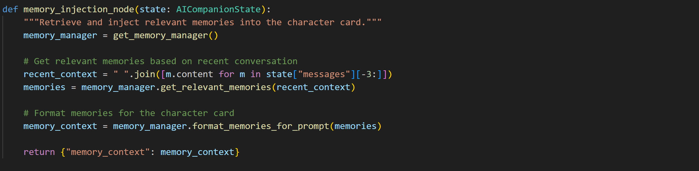

This node uses the MemoryManager class to retrieve relevant memories from Qdrant - essentially performing a vector search to find the top-k similar embeddings. Then, it transforms those embeddings (vector representations) into text using the format_memories_for_prompt method.

Once that's done, the formatted memories are stored in the memory_context property of the graph. This allows them to be parsed into the Character Card Prompt - the one that defines Kylie's personality and behaviour.

## Module 4 (Kylie's Voice)

Kylie's audio pipeline works a lot like the vision pipeline.

Instead of processing images and generating new ones, we're dealing with audio: converting speech to text and text back to speech.

Take a look at the diagram above to see what I mean.

It all starts when you send a voice note. The audio gets transcribed, and the text is sent into the LangGraph workflow. That text, along with your message, helps generate a response, sometimes with an accompanying voice note. We'll explore how conversations are shaped using the incoming message, chat history, memories, and even current activities.

So, in a nutshell, there are two main flows: one for handling audio coming in and another for generating and sending new audio out.

## Audio In: Speech-to-Text (STT)

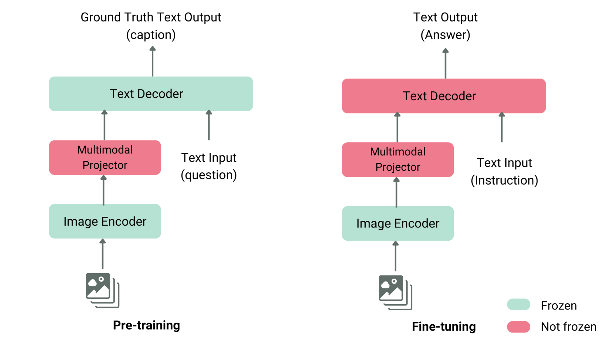

Speech-to-Text models convert spoken audio into written text, enabling Kylie to understand voice messages just like text messages. They process audio waveforms, identify phonemes and words, and generate accurate transcriptions even with background noise or different accents.

For Kylie, STT is essential for making voice notes accessible. It lets her transcribe your voice messages accurately, understand your spoken requests, and generate responses that go beyond just text - bringing real conversational context into interactions.

To integrate STT into Kylie's codebase, I built the SpeechToText class as part of Kylie's modules. We're using Groq's Whisper model (whisper-large-v3-turbo) for fast and accurate transcription.

## Audio Out: Text-to-Speech (TTS)

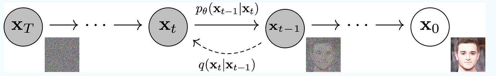

Text-to-Speech models convert written text into natural-sounding speech, enabling Kylie to respond with voice notes just like a real person. They process text, generate phonemes, and synthesize audio waveforms that sound human-like with proper intonation and emotion.

For Kylie, TTS is crucial for creating natural and engaging voice responses. Whether she's responding with a voice note or expressing emotions, these models ensure her audio outputs match the conversation while staying warm and conversational.

There are tons of TTS services out there - growing fast! - but we found that ElevenLabs gave us solid results, creating the natural, expressive voice we wanted for Kylie's personality.

Plus, it offers great voice quality and customization options, which is a huge bonus! 

The workflow is simple: first, we generate a text response based on the chat history and Kylie's activities

Next, we use this text to synthesize speech using ElevenLabs TTS, with voice settings optimized for natural conversation.

The synthesize method then generates the audio bytes and stores them in the LangGraph state's audio_buffer.

Finally, the audio gets sent back to the user via the WhatsApp endpoint hook, giving them a voice representation of what Kylie is saying!

## Module 5 (Kylie's Vision)

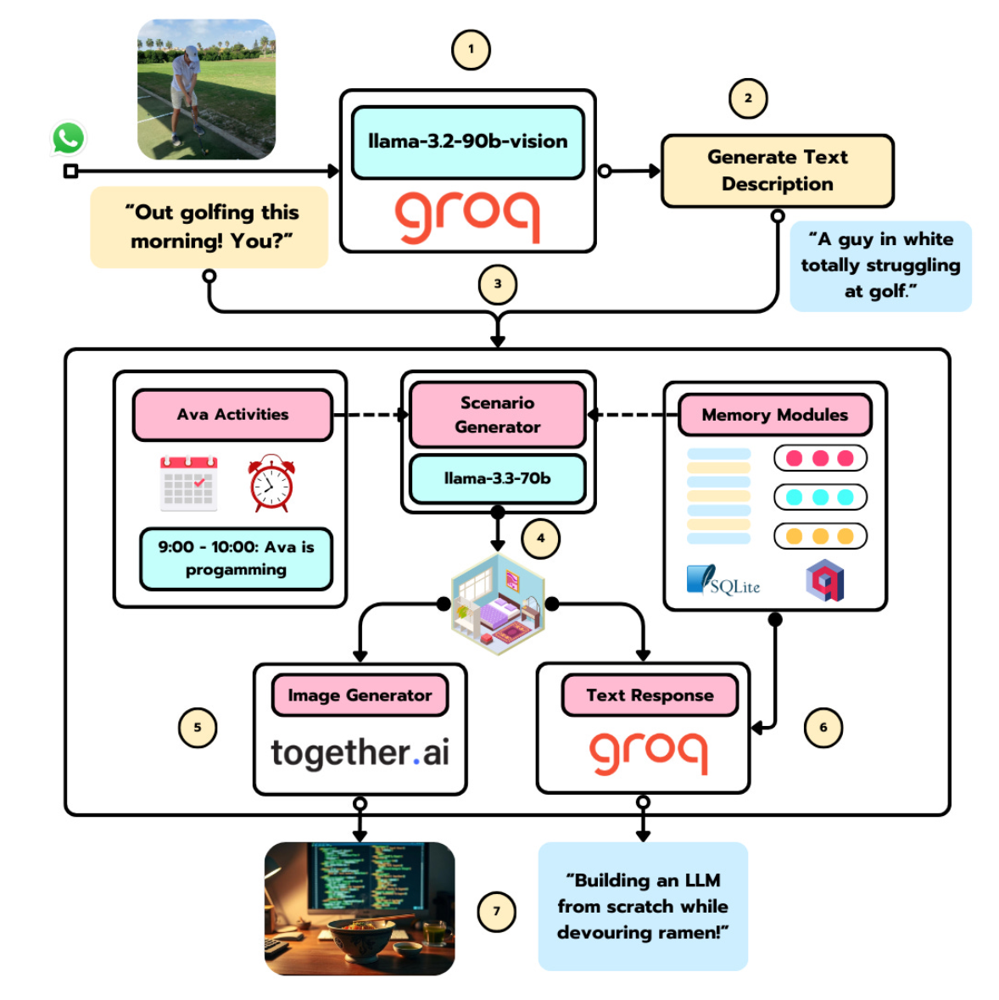

Kylie’s vision pipeline works a lot like the audio pipeline.

Instead of converting speech to text and back, we’re dealing with images: processing what comes in and generating fresh ones to send back.

Take a look at the diagram above to see what I mean.

It all starts when I send a picture golfing. The image gets processed, and a description is sent into the LangGraph workflow. That description, along with my message, helps generate a response, sometimes with an accompanying image. We’ll explore how scenarios are shaped using the incoming message, chat history, memories, and even current activities.

So, in a nutshell, there are two main flows: one for handling images coming in and another for generating and sending new ones out.

## Image In: Visual Language Models (VLM)

Vision Language Models (VLMs) process both images and text, generating text-based insights from visual input. They help with tasks like object recognition, image captioning, and answering questions about images. Some even understand spatial relationships, identifying objects or their positions.

For Kylie, VLMs are key to making sense of incoming images. They let her analyze pictures, describe them accurately, and generate responses that go beyond just text - bringing real context and understanding into conversations.

To integrate the VLM into Kylie’s codebase, I built the ImageToText class as part of Kylie’s modules.

## Image Out: Diffusion Models

Diffusion models are a type of generative AI that create images by refining random noise step by step until a clear picture emerges. They learn from training data to produce diverse, high-quality images without copying exact examples.

For Kylie, diffusion models are crucial for generating realistic and context-aware images. Whether she’s responding with a visual or illustrating a concept, these models ensure her image outputs match the conversation while staying creative and unique.

There are tons of diffusion models out there - growing fast! - but we found that FLUX.1 gave us solid results, creating the realistic images we wanted for Kylie’s simulated life.

Plus, it’s free to use on the Together.ai platform, which is a huge bonus! 
The workflow is simple: first, we generate a scenario based on the chat history and Kylie's activities

Next, we use this scenario to craft a prompt for image generation, adding guardrails, context, and other relevant details.

The generate_image method then saves the output image to the filesystem and stores its path in the LangGraph state.

Finally, the image gets sent back to the user via the WhatsApp endpoint hook, giving them a visual representation of what Kylie is seeing!

